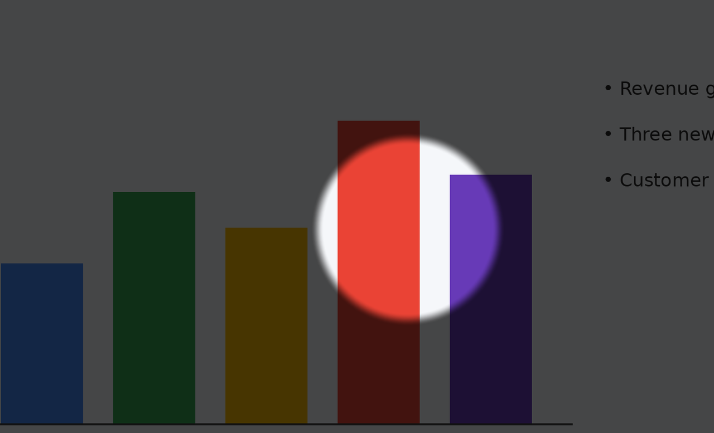
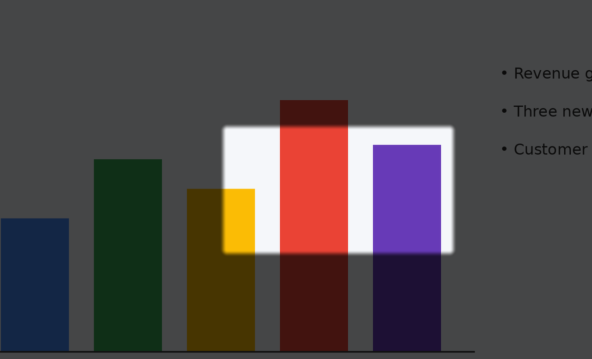
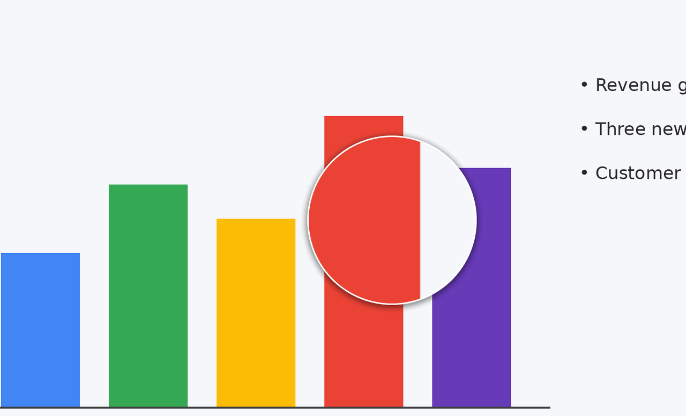
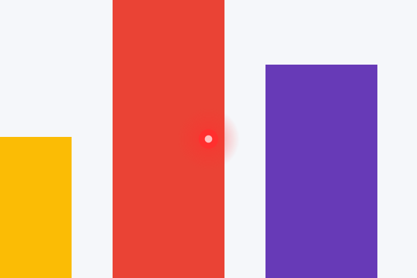
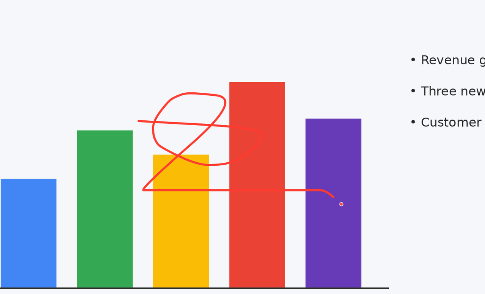

# Limelight

**Smooth spotlight, magnifier, laser and drawing effects for the Logitech Spotlight 2 — without Logi Options+.**

A lightweight (≈0.6 MB), fully local, open-source Windows 11 app. No account, no telemetry,
no cloud. It talks to the remote directly over Logitech's HID++ protocol, the same way
[Mouser](https://github.com/TomBadash/Mouser) does for Logitech mice.



| Squarelight | Magnifier |
|---|---|
|  |  |
| **Laser dot** | **Draw** |
|  |  |

## Features

- **Five effects** — Spotlight, Squarelight, Magnifier, on-screen Laser dot and Draw.
- **Light press and hard press** on the highlight button each get their own effect, like
  Logitech's app. The remote's two pressure levels are read directly, so effects appear the
  instant you press and vanish the instant you let go.
- **Smooth**: frames are synced to your display's refresh (60/120/144 Hz), only the pixels that
  change are redrawn, effects fade in and out, and the pointer is hidden while an effect is on.
- **Vibration** feedback on hard press (or every press).
- **Real laser** support through a guided *Laser finder* (see below).
- Double-tap the highlight button to **click** a link or a video.
- Works over **Bluetooth** and the **Logi Bolt** USB receiver, keeps working after the remote
  sleeps and wakes up, handles multiple monitors and mixed DPI.
- Keyboard shortcuts so you can use the effects without the remote (e.g. in online meetings).
- Battery level in the tray tooltip. Follows Windows light/dark mode.

## Install

1. Download **`Limelight-Setup.exe`** from [Releases](../../releases).
2. Run it. It installs for your user only (no admin rights) into
   `%LOCALAPPDATA%\Programs\Limelight`, adds a Start menu entry and, if you keep the box
   ticked, starts with Windows.
3. Windows SmartScreen may say *"Windows protected your PC"* because the app is not
   code-signed. Click **More info → Run anyway**.
4. **Quit Logi Options+** (right-click its tray icon) or uninstall it — both apps would try to
   control the remote at the same time.

Prefer no installer? `Limelight.exe` is a single portable file; just run it.

## How to use each mode

Limelight lives in the notification area next to the clock. Left-click the icon for
**Settings**, right-click it for the quick menu.

| Mode | How to get it |
|---|---|
| **Spotlight** | Hold the highlight button **lightly** (default). |
| **Laser dot** (on-screen) | Press the highlight button **hard** (default). |
| **Squarelight** | Settings → *Light press* or *Hard press* → **Square**. |
| **Magnifier** | Settings → *Light press* or *Hard press* → **Zoom**. |
| **Draw** | Settings → *Light press* or *Hard press* → **Draw**. Hold the button and move the remote to draw; Next/Back/Esc clears it (or *Clear drawing* in the menu). |
| **Real laser** | Run the Laser finder once (below), then switch on **Real laser** in Settings or the tray menu. |
| **Click** | Double-tap the highlight button. |

Release the button and the effect fades away. Next and Back change slides as usual.

**Keyboard (no remote needed):** `Ctrl+Alt+F1` Spotlight · `F2` Squarelight · `F3` Magnifier ·
`F4` Laser dot · `F5` Draw · `F6` Clear drawing · `Esc` stops. Each shortcut toggles the effect;
it follows your mouse.

Everything else — sizes, how much the screen is dimmed, zoom level, laser and pen colours,
vibration strength, hiding the pointer — is in Settings, and the effect previews live while you
drag a slider.

## The real laser (Laser finder)

The Spotlight 2 has a real Class 1 laser diode at the tip. Logi Options+ switches it on with a
command that, as far as I know, nobody has published yet. Limelight includes a guided finder
that works it out on your own remote:

1. Right-click the tray icon → **Laser finder & diagnostics…** (or Start menu →
   *Limelight diagnostics*).
2. Choose **4 — Laser finder**. Point the remote at a wall (never at eyes).
3. It asks you to press a button and answer **y/n**: did the laser light up? It tries the
   remote's own laser functions one by one. Nothing is changed permanently.
4. When it finds the combination it saves it, and **Real laser** becomes available in
   Settings and the tray menu.

If it doesn't find it, a report is saved on your Desktop as `Limelight report.txt` —
please attach it to an issue so the laser can be supported for everyone. The same tool can
show what every button sends (option 2) and test vibration (option 3).

## Troubleshooting

- **"Looking for your Spotlight 2…"** — press any button to wake the remote. Over Bluetooth,
  make sure it is paired in Windows Settings. With the USB receiver, make sure the receiver that
  came with the remote is plugged in.
- **Effects flicker or appear twice** — Logi Options+ is still running. Quit or uninstall it.
- **The pointer disappeared** — it is only hidden while an effect is showing. If Limelight was
  killed at that exact moment, start Limelight again (it restores the pointer at startup) or sign
  out and back in.
- **Log file:** `%LOCALAPPDATA%\Limelight\limelight.log`. Settings: `%APPDATA%\Limelight\settings.ini`.

## Building from source

The app is plain C++17 + Win32 (GDI, GDI+, DXGI, Raw Input, HID), with no other dependencies.

**On Linux (cross-compile):**

```bash
sudo apt install g++-mingw-w64-x86-64-posix nsis
./build.sh            # dist/Limelight.exe and dist/Limelight-Setup.exe
./build.sh test       # also builds build/test_presenter.exe
```

**On Windows:** install [MSYS2](https://www.msys2.org/), open the *MSYS2 MINGW64* shell and run

```bash
pacman -S --needed mingw-w64-x86_64-gcc mingw-w64-x86_64-nsis
./build.sh
```

The GitHub Actions workflow in `.github/workflows/build.yml` builds both files on every push,
runs the protocol tests and a smoke test on a real Windows runner, and attaches the files to a
release when you push a tag such as `v1.0.0`.

`build/test_presenter.exe` runs the real HID++ code against a simulated Spotlight 2 (both over
Bluetooth and behind a Bolt receiver shared with a mouse): `test_presenter.exe` and
`test_presenter.exe receiver`.

## How it works

| File | What it does |
|---|---|
| `src/presenter.cpp` | Finds the remote, diverts its buttons over HID++, re-applies that after sleep, vibration, battery. |
| `src/hidpp.cpp` | HID++ 2.0 messages: feature lookup, controls, `setCidReporting`. |
| `src/hid.cpp` | Windows HID enumeration and overlapped I/O. |
| `src/overlay.cpp` | Render thread: per-pixel-alpha layered windows, vblank pacing, fades, effects. |
| `src/raster.cpp` | The pixel work: soft-edged holes, laser sprite, magnifier lens, anti-aliased ink. |
| `src/main.cpp` | Tray app: what each button does, hotkeys, raw input, settings plumbing. |
| `src/ui.cpp` | The custom-drawn settings window. |
| `src/diag.cpp` | `Limelight.exe --diagnostics`: report, button watcher, vibration test, Laser finder. |

What the Spotlight 2 does over HID++ (none of it is documented by Logitech):

- It only accepts **long** HID++ reports (`0x11`, 20 bytes). Over Bluetooth it is device `0xFF`;
  behind a Logi Bolt receiver it is device 1–6.
- The buttons report nothing until you ask with `0x1B04 setCidReporting`. Control `0x00D8` is the
  highlight button's light press and `0x01A8` its hard press. Raw XY must stay off, or the gyro
  stops moving the pointer.
- Commands sent back to back are silently dropped, so they are spaced out.
- Vibration is feature `0x19B0` (`setState` = function 2, `playWaveform` = function 4).

Credits: the button and pressure-level findings come from
[spotlight2-linux (foco)](https://github.com/fmesasc/spotlight2-linux) and the Spotlight 2 work in
[Projecteur](https://github.com/gbin/Projecteur); [Solaar](https://github.com/pwr-Solaar/Solaar)'s
documentation of HID++ was invaluable.

Not affiliated with or endorsed by Logitech. "Logitech", "Spotlight" and "Logi Options+" are
trademarks of Logitech.

## License

MIT — see [LICENSE](LICENSE).
